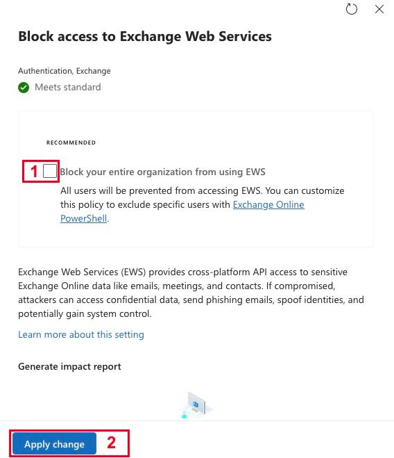
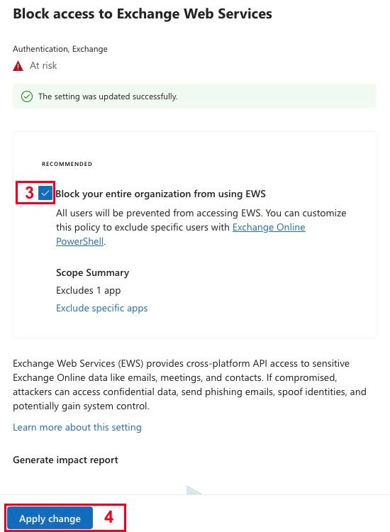
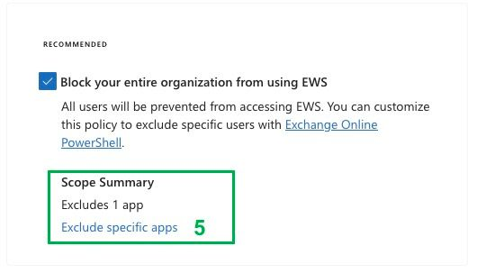

※ この記事は、[Exchange Online EWS application stopped working? Do this.](https://techcommunity.microsoft.com/blog/exchange/exchange-online-ews-application-stopped-working-do-this-/4566215) の抄訳です。最新の情報はリンク先をご確認ください。この記事は Microsoft Copilot および GitHub Copilot を使用して抄訳版の作成が行われています。

[お知らせ](/blog/exchange-online-ews-your-time-is-almost-up/)しているとおり、Exchange Online では Exchange Web Services (EWS) プロトコルを無効化しています。EWS は、次のようなアプリケーションで使われています。

- macOS の Apple Mail / Calendar
- macOS の従来の Outlook
- Outlook デスクトップ アドイン
- 古いバージョンの従来の Outlook for Windows
- お客様がソフトウェア ベンダーから購入したバックアップ アプリケーションなど

EWS が無効になると、ユーザー名やパスワードを繰り返し求められたり、EWS プロトコルを利用できないというエラーが表示されたりすることがあります。
これまでの発表のとおり、EWS の廃止は現在進行中です。進捗については[こちらの記事](/blog/ews-deprecation-is-here-what-this-means-to-you/)をご確認ください。

### EWS アプリケーションが動作しなくなった場合

<span style="color: red; background-color: #ffff99; font-weight: bold;">なお、Microsoft サポートでは、後述の手順をお客様に代わって実施することはできません。<u>EWS を再度有効化するには、テナント管理者ご自身で以下の手順を実施していただく必要があります。</u></span>

- テナントの[メッセージ センター](https://admin.cloud.microsoft/#/MessageCenter)で、件名が「*Action may be required: EWS will be disabled in your tenant in 7 days*」または「*EWS has been disabled in your tenant*」の投稿を検索します。これにより、テナントで EWS が無効になった時期を確認できます。

Microsoft がテナントの EWS を無効にしたことを示す投稿がある場合は、次のいずれかの方法で再度有効にします。

#### 方法 1 (最も簡単): Microsoft 365 管理センターのベースライン セキュリティ モードを使う

- Microsoft 365 管理センターの[ベースライン セキュリティ モード](https://admin.cloud.microsoft/#/baselinesecuritymode)を開きます。
- [Block access to Exchange Web Services] の行を選択します。
  - 
- [Block your entire organization from using EWS] のチェックを外し、[Apply change] を選択します。
  - 
- 同じ [Block your entire organization from using EWS] に再度チェックを入れ、もう一度 [Apply change] を選択します。
  - 
- これでテナントの EWS が再度有効になります。<span style="color: red;">通常、設定変更が反映されてアプリケーションが動作し始めるまで 1 時間以内ですが、*まれに 4 時間かかることがあります*。</span>

<span style="background-color: #ffff99;">「Block」の設定にチェックが入っている状態でも、テナントの設定は EWS を許可する状態 (`EWSEnabled = True`) になり、特定のアプリが<I> EWS 許可リスト</I>に登録されます。</span>

- テナントで EWS の使用を許可されているアプリは、[Scope Summary] で確認できます。リストに表示されているアプリは、ブロック対象から除外されています。
  - 

#### 方法 2 (より細かく制御): Exchange Online PowerShell を使う

- [Exchange Online PowerShell モジュールをインストール](https://learn.microsoft.com/powershell/exchange/exchange-online-powershell-v2?view=exchange-ps#install-and-update-the-exchange-online-powershell-module)し、[Exchange Online PowerShell に接続](https://learn.microsoft.com/powershell/exchange/connect-to-exchange-online-powershell?view=exchange-ps)します。
- 接続した PowerShell ウィンドウで、次のコマンドを実行します。

  ```powershell
  Get-OrganizationConfig | Fl EWSEnabled
  ```

- 結果が `EwsEnabled : False` の場合、テナントで EWS が無効になっています。
- 次のコマンドを実行します。

  ```powershell
  Set-OrganizationConfig -EWSEnabled $true
  ```

- これでテナントの EWS が再度有効になります。通常、設定変更が反映されてアプリケーションが動作し始めるまで 1 時間以内ですが、*まれに 4 時間かかることがあります。*

### テナントで許可されている EWS アプリケーションを確認する

**ベースライン セキュリティ モードを使う場合は**、前述の画面にある [Scope Summary] を確認し、[Exclude specific apps] でリストを編集します。

**Exchange Online PowerShell を使う場合は**、次のコマンドを実行します。

```powershell
Get-OrganizationConfig -RetrieveEwsOperationAccessPolicy | Fl EwsAllowedAppIDs
```

このコマンドでは、過去 60 日間にテナント内で使用されたことを Microsoft が検出した EWS アプリケーションの一覧が表示されます。これらのアプリは EWS 許可リスト (`EwsAllowedAppIDs`) に追加済みです。前述の手順で EWS を再度有効にした後、すべて正常に動作していれば、この一覧を変更する必要はありません。アプリを追加することもできます。詳しくは[EWSAllowedAppIDs に関する記事](/blog/introducing-ewsallowedappids-preparing-for-the-final-phase-of-ews-retirement/)をご確認ください。

<span style="color: red;">許可リストの変更が反映されるまで 24 時間かかります。</span>

### 上記の手順は、2027 年 4 月までの一時的な対応

現在は EWS 無効化の最初の段階であり、EWS を再度有効にできます。**この方法で再有効化できるのは 2027 年 4 月までです。**

長期的には、EWS を使わないバージョンのアプリケーションに更新する必要があります。*アプリケーション ベンダーに更新版を問い合わせるか、自分で作成したアプリケーションの場合は EWS を使わないようにコードを変更してください*。2027 年 4 月以降、クライアント アプリケーションで EWS は利用できなくなります。
